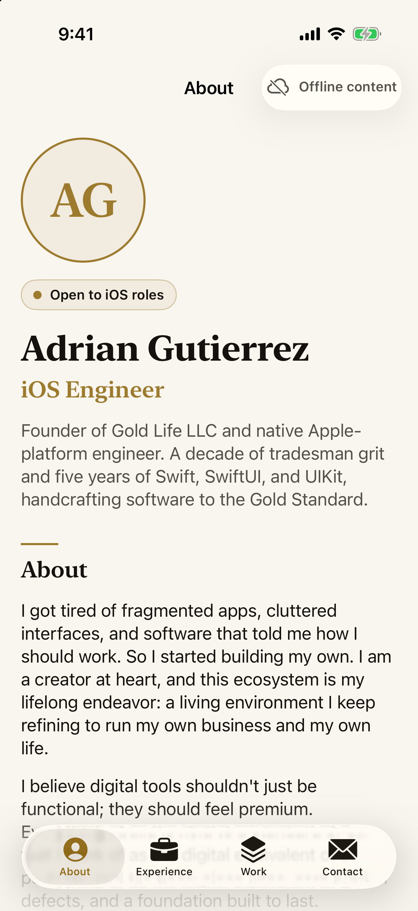
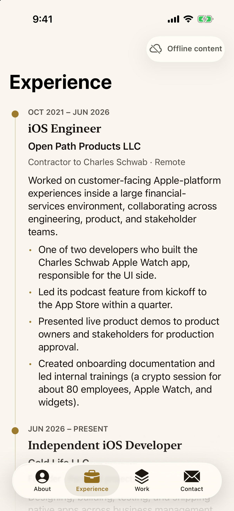
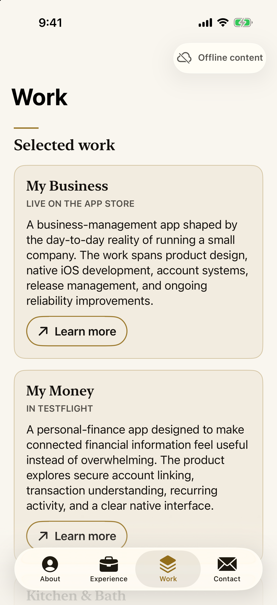
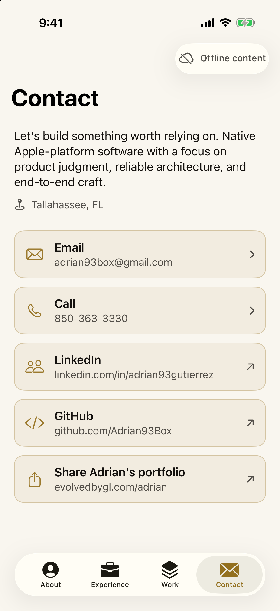
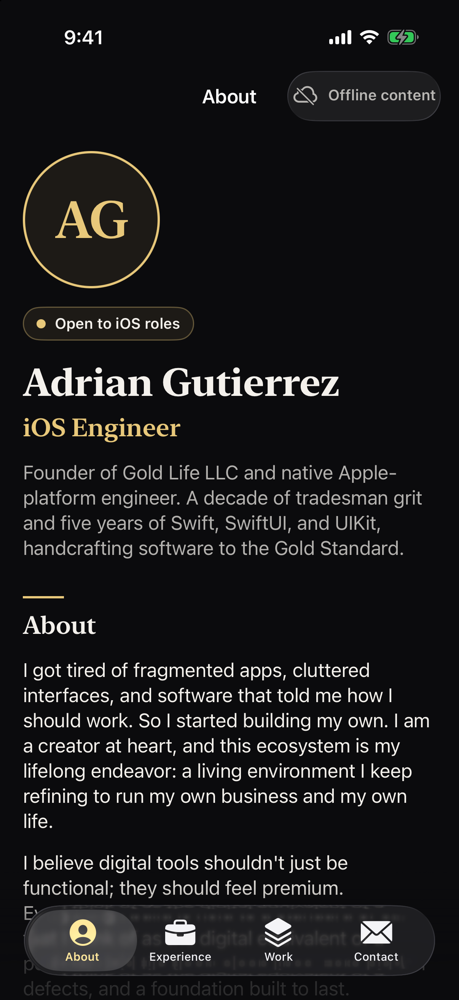
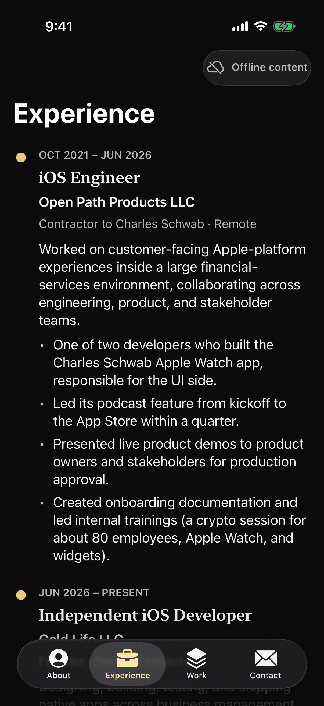
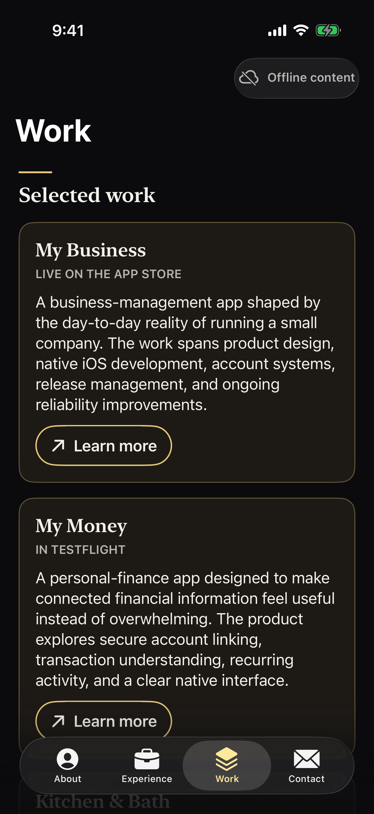
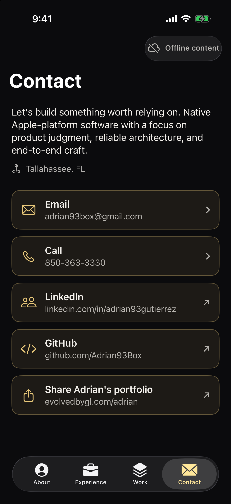
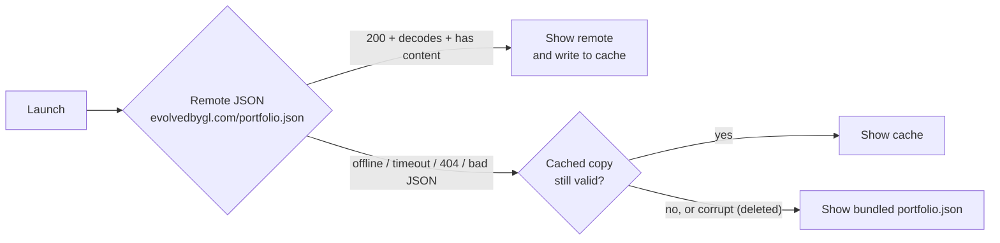

# Adrian Gutierrez — iOS Portfolio

A native iOS app that **is** my professional portfolio: the SwiftUI version of
[evolvedbygl.com/adrian](https://evolvedbygl.com/adrian). I'm Adrian Gutierrez, an iOS engineer
open to roles, and this repo is meant to do two jobs at once:

1. Tell you who I am and what I've built (the app).
2. Show how I build (the code).

Everything is pure Apple frameworks: SwiftUI, WidgetKit, SafariServices, Foundation. There are no
third-party dependencies, no API keys, no accounts, no backend, and no analytics.

| About | Experience | Work | Contact |
| :---: | :---: | :---: | :---: |
|  |  |  |  |
|  |  |  |  |

Light and dark mode follow the system setting and use the website's exact colour tokens. The small
"Offline content" pill in the corner appears whenever the app is showing cached or bundled content
instead of a fresh download.

## Run it

- Xcode 16 or newer, iOS 17+ (Swift 6 language mode).
- Open `Portfolio.xcodeproj`, pick the **Portfolio** scheme and any iPhone simulator, press Run.
- No setup, no package resolution, no secrets. To run on a physical device, choose your own
  signing team under *Signing & Capabilities*.
- Run the tests with `⌘U`, or:

```sh
xcodebuild test -project Portfolio.xcodeproj -scheme Portfolio \
  -destination 'platform=iOS Simulator,name=iPhone 17 Pro'
```

To try the widget, run the app once, then long-press the Home Screen → **+** → **Portfolio Widget**
(small or medium). Tapping it opens the Contact tab.

## Architecture

**MVVM with protocol-based services and constructor injection.** Views are dumb: they render state
and forward intents. `@Observable` view models own state. Services own I/O. There are no singletons;
`PortfolioApp` is the composition root and builds every dependency once.

```text
Portfolio/
├── App/             PortfolioApp (composition root), RootView (tab shell), AppTab (tabs + deep links)
├── Core/            Everything the features share
│   ├── Models/        Portfolio (Codable content), SafeURL, YearMonth
│   ├── Services/      APIClient, PortfolioService (protocol + live + mock), PortfolioCache, AppError
│   └── ViewModels/    PortfolioViewModel
├── Design/          Colors (exact hex tokens), Typography (named roles)
├── Shared/
│   └── Components/    SectionHeader, LoadableContent, OfflineIndicator, SafariView, ScreenChrome
├── Features/        One folder per tab, each with its own Views / ViewModels / Components
│   ├── About/         AboutView · PortraitView, AvailabilityBadge
│   ├── Experience/    ExperienceView · TimelineRow
│   ├── Work/          WorkView · ProjectCard, CapabilityGroupView
│   └── Contact/       ContactView · ContactViewModel · ContactButton
└── Resources/       Assets.xcassets, portfolio.json (bundled fallback), PrivacyInfo.xcprivacy
PortfolioWidget/   WidgetKit extension
PortfolioTests/    Mirrors the app: Core/, Features/, App/, plus Support/ (mock URLProtocol) and Fixtures/
Scripts/           Release tooling (archive + TestFlight upload); no credentials in the repo
```

### The content fallback chain

All content comes from one JSON document decoded into the `Portfolio` model. No copy is written
in views. `LivePortfolioService` resolves it through a chain:



Why it exists: the app should always show something real. A recruiter opening it on a plane, or
the day the website is down, still sees the full portfolio. And I can update my résumé content
without shipping a new build.

- **On launch** the view model shows the best *local* copy immediately (cache, else bundle), then
  refreshes from the network in the background, so there is never a spinner when content exists.
  Pull-to-refresh on the About tab re-runs the same refresh.
- **Failures are silent by design.** Connectivity problems never produce an error screen; the only
  signal is the subtle offline pill. The error and retry screen exists only for the (practically
  impossible) case where the network, cache and bundle are *all* unusable.
- **The cache never holds bad data.** A remote payload is cached only after it decodes *and*
  contains something to show (so a `{}` or an HTML error page can't replace good content). A cached
  file is re-validated on read; a corrupt one is deleted. Payloads over 1 MB are rejected.
- **Decoding is forgiving.** Missing fields fall back to defaults and unknown fields are ignored,
  so a newer or partial JSON file doesn't crash older builds.
- **The JSON is treated as untrusted input.** Every URL the app can open (mail, call, web links) is
  built through `SafeURL`, which only allows `http(s)` links with a host, plain `mailto:` addresses
  (no header injection like `?cc=`), and plausible phone numbers. This also protects
  `SFSafariViewController`, which raises an exception for non-web schemes.

### Tabs

| Tab | Content |
| --- | --- |
| About | Portrait (monogram placeholder until an asset is added), availability badge, name, headline, tagline, about text. Pull to refresh. |
| Experience | Timeline of roles and education, then the short "Before software" story. |
| Work | The three selected apps (links open in an in-app Safari sheet), then grouped capabilities. |
| Contact | Email, Call, LinkedIn, GitHub, and a share sheet for the website URL. |

Every tab handles **loading**, **error** (with retry) and **empty** states through one shared
`LoadableContent` wrapper plus `EmptySectionView`, so no screen can render blank.

## What this demonstrates

| Feature | Skills on display |
| --- | --- |
| `APIClient` + `Portfolio` models | `URLSession` + async/await, typed error mapping (`AppError`), status and size validation, forgiving `Codable` with defaults |
| Remote → cache → bundle chain | Offline resilience, cache validation and self-healing, graceful degradation, treating remote data as untrusted |
| `PortfolioViewModel`, `ContactViewModel` | MVVM with `@Observable` and `@MainActor`, idempotent start, refresh shielded from SwiftUI task cancellation |
| `PortfolioService` / `MockPortfolioService` | Protocol-oriented design and dependency injection; one mock powers previews and tests |
| `PortfolioWidget` | WidgetKit small + medium families, `containerBackground`, `widgetURL` deep linking, code shared with the app target |
| Deep links (`portfolio://contact`) | URL scheme registration, `onOpenURL`, a single `AppTab` type shared by app and widget |
| `Colors`, `Typography`, components | Design system: exact light/dark tokens via dynamic colours, named type roles (swap in custom fonts in one file), custom `Layout` (`FlowLayout`) |
| Accessibility | Labels, hints and traits on every control, decorative glyphs hidden, Dynamic Type via text styles, 44 pt minimum targets |
| Tests | XCTest with a mock `URLProtocol`: the fallback chain in order, malformed and oversized responses, corrupt caches, URL-safety fuzz cases, view model state transitions |
| Project hygiene | Swift 6 language mode, zero warnings, no force unwraps or `try!`, privacy manifest, no third-party code |

SwiftUI previews exist for every screen (loaded light and dark, offline, loading, failed, empty), all
driven by the mock service.

## For the owner: updating content

The app's copy lives in one file, `Portfolio/Resources/portfolio.json`.

- **Change it in the app only:** edit that file and rebuild. It's the offline fallback.
- **Change it without a new build:** publish the same JSON at
  `https://evolvedbygl.com/portfolio.json`. In the website repo that means putting it at
  `public/portfolio.json`. The app fetches it on launch and on pull-to-refresh, then caches it.
- **Contact details** (email, phone, LinkedIn, GitHub, website URL) are in the `contact` block.
  Leave a field empty and that button disappears.
- **Portrait:** add an image set named exactly `Portrait` to `Portfolio/Resources/Assets.xcassets`.
  The placeholder monogram is used until it exists.
- **Fonts:** if the site's font files are added later, change only `Design/Typography.swift`.

Dates are `yyyy-MM`. Omit `endDate` for a current role.

```jsonc
{
  "name": "…",                 // added to the base schema: used by the hero and share sheet
  "headline": "iOS Engineer",
  "tagline": "…",
  "availability": "Open to iOS roles",
  "about": ["paragraph", "paragraph"],
  "experience": [{
    "title": "…", "company": "…", "detail": "…",
    "summary": "…",            // optional one-paragraph overview
    "startDate": "2021-10", "endDate": "2026-06",
    "bullets": ["…"]
  }],
  "projects": [{
    "name": "…", "description": "…",
    "status": "Live on the App Store",   // optional
    "linkLabel": "Learn more", "linkURL": "https://…"
  }],
  "capabilityGroups": [{ "title": "Apple platforms", "items": ["Swift & SwiftUI"] }],
  "beforeSoftware": ["paragraph"],
  "contact": {
    "email": "…", "phone": "…", "linkedIn": "https://…", "github": "https://…",
    "website": "https://evolvedbygl.com/adrian",
    "message": "…", "location": "…"       // both optional
  }
}
```

## Notes

- **Bundle IDs** are `com.evolvedbygl.portfolio` (app) and `com.evolvedbygl.portfolio.widget`
  (widget). Change them in the target settings if you fork this.
- The app deliberately has no CMS, notifications, analytics, résumé export or watchOS target.
- Debug builds accept a launch argument, `-initialTab about|experience|work|contact`, used to
  produce the screenshots above.

## License

[MIT](LICENSE) © 2026 Adrian Gutierrez. The portfolio *content* (text, name, contact details) is
personal; please don't republish it as your own.
